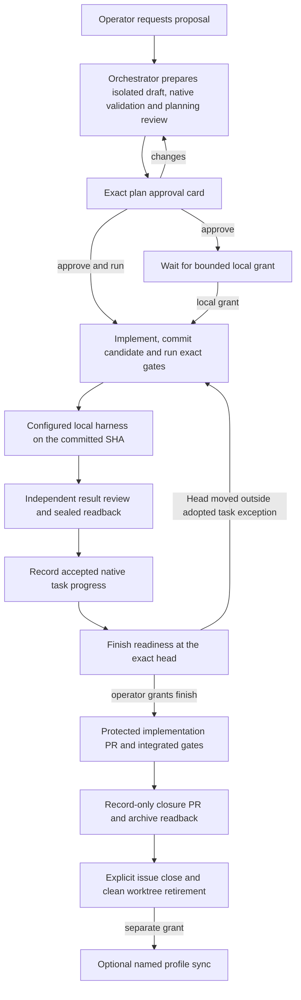
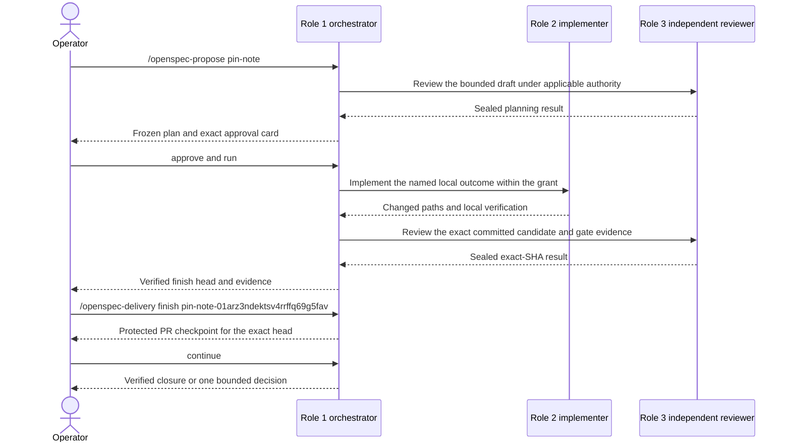

# OpenSpec operator tutorial

Start from the [workflow](openspec-workflow.md) and use the [operator runbook](openspec-operator-runbook.md)
for checkpoint and recovery commands. The integrated parent of the frozen plan
selects the policy. Use the original records when picking up a change in a new
session.

## Walk through one change





A verified adopting policy can reuse the sealed review of a checkbox-only
child's exact parent. This route still gates the child independently. Under
inherited policy, rerun the review for the actual final head after a task
commit.

### Steer with three or four short turns

1. **Propose.** Send `/openspec-propose pin-note` with the outcome and its
   boundaries, or point to a readable Change Brief. The orchestrator reads the
   project's standing policy from the verified integrated baseline, checks
   revisions and dependencies, and prepares the authorized native plan. Give
   it the goal and any exceptions you want. It can read the policy and SHAs
   from repository evidence. Under an adopting proposal policy, expect a
   validated and independently reviewed plan-only commit and exact approval
   card. The orchestrator may create or reuse a proposal-time issue within
   the held authority. Proposal authority stops at planning.
2. **Approve.** Reply `approve and run` to the verified current card when both
   the exact plan and displayed local terms are acceptable. The orchestrator
   records exact approval and a separate bounded local grant, then verifies
   both before launching. An admitted local run can implement, verify,
   independently review and record accepted work, including previewed
   commits when authorized. Reply `approve` to approve the displayed plan
   alone. Use `changes: preserve keyboard access` to revise it and wait for
   the replacement identity before deciding.
3. **Grant local execution if you approved alone.** Send
   `/openspec-next <full-change>` with a separate bounded local grant covering
   the eligible scope, restrictions, roles, gates, budget and stop.
4. **Authorize protected finish.** After verifying readiness for the exact
   head, send `/openspec-delivery finish <full-change>`. This covers
   protected publication and closeout under the selected policy. If the
   runbook calls for `continue`, resume the same PR and head only after fresh
   readback within the retained grant and deadline.

Use the full change name after registration. In Codex, use `$` for installed
skill names, such as `$openspec-next` and `$openspec-delivery`. Follow the
[command map](openspec-workflow.md#host-spelling) for your host.

Use these modifiers when you want to narrow the selected workflow.

| Modifier | When to use it |
| --- | --- |
| `draft only` | Keep an authorized proposal uncommitted and stop at the draft boundary after applicable planning checks. |
| `no commits` | Preserve an uncommitted draft during planning or prohibit commits during local execution. Stop if the next gate requires a committed candidate. |
| `group 1` | Limit a Task-Guided execution grant to eligible work in native group 1. Carry the limit into corrections and resumption. |
| `keep the worktree` | Narrow cleanup authority so the dedicated worktree remains after finish. |
| `task-guided` | Request Task-Guided during planning when you want a prescribed method, ordered dependencies or staged authority. Keep the approved mode on resume. |
| `explicit` | Use the host admission file's per-run explicit review override where supported. Require an exact single-run grant before that review launches. |

### Write a reviewable goal or Change Brief

State the observable outcome and its fail-closed alternative together.
For example, let a widget owner pin one note across reopenings when the
integrated baseline supports stable note identity. If read-only checks cannot
verify that dependency, stop at planning and record what needs resolution.
Before proposing, verify pinned facts such as the integrated parent, required
capability, existing change or issue binding, and intended paths.

Keep hard invariants and adaptable legacy assumptions distinct. Keeping the
pin private to the owner is an invariant. The current list-sorting method is
an assumption the implementation may revisit. Describe the result and its
acceptance. Specify a mechanism only when it defines a necessary boundary,
such as an authority check or required safety control. Name exclusions so the
reviewer can spot drift.

- **Planning acceptance** checks that the outcome, scope, dependencies,
  authority, gates and stop are explicit, native validation passes, and the
  required planning review covers the exact plan.
- **Execution acceptance** checks visible behavior such as pin, unpin and
  reopen, plus declared gates and independent review of the exact candidate.
  Keep execution tasks and verification with native OpenSpec.

Goal-First fits eligible reversible local work under an adopting integrated
parent. Give the agent one bounded outcome with verifiable acceptance and
room to choose the implementation. Use Task-Guided for prescribed methods,
ordered dependencies, staged authority, or an unproved reversible local
boundary. See the [delivery mode policy](../skills/software-development/openspec-delivery/references/delivery-policy.md#mode-selection-and-local-result)
and the optional [Change Brief template](../skills/delivery-operations/wiki-delivery-sync/templates/change-brief.md).

### Handle an exception

1. Read back the exact change, checkpoint and evidence first. For an
   interrupted or uncertain action, determine whether the original process or
   write took effect before resuming or retrying.
2. If the fix fits the approved scope, safeguards, remaining authority and
   budget, correct it and rerun the affected checks. A local test regression
   can enter this loop. Preserve the original evidence and reverify the new
   candidate under the applicable gates and review policy.
3. Stop on material drift, unresolved process custody, a blocked safeguard,
   exhausted budget or a missing grant. Report the exact stop, supporting
   evidence, remaining bounds and the smallest decision needed. Resume from
   verified state after the applicable decision. A changed frozen plan needs
   fresh exact approval and a matching local grant.

#### Never Auto-Approves

- Exact approval of a frozen plan and its separate bounded local grant.
- Material changes to approved scope, safeguards, permissions or review
  binding, including a different protected head that needs fresh admission.
- Paid or external work outside existing verified authority. Check the
  integrated review allowance, exact standing $0 triggers and separately
  granted bundled events before acting. Other paid or unknown triggers,
  external tests, retries, deploy previews and tunnels need their applicable
  separate grants.
- Protected publication and closeout for the named finish head.
- Post-release sync or other live changes to an installed profile. Authorize
  the named client or profile, immutable source revision and selected scope.

### Roll over at a verified checkpoint

Use a fresh session at a settled phase boundary or when context use approaches
60 percent. At the fresh-session checkpoint, open the registered worktree and
its approved records directory. Use the footer's sealed checkpoint and
`$openspec-next inspect <full-change>` to verify the worktree owner, HEAD,
frozen digest, candidate or interrupted attempt, original grant, restrictions,
deadline and remaining budgets. Keep the original attempt and claim when
settlement remains uncertain. A new session carries the original authority.

After separately authorized skill sync, compare the complete installed
package bytes and versions with the approved source. Open a fresh session in
the selected client or profile and check that it discovers and loads the
updated skill. See [profile sync and verification](openspec-operator-runbook.md#optional-profile-sync).

## Codex CLI launch and approvals

Use this launch template at an authorized checkpoint. Set the variables to
the exact registered worktree and approved records paths from the footer.

```sh
codex --approve-for-me -C "$CHANGE_WORKTREE" --add-dir "$CHANGE_RECORDS"
```

`-C` sets the working root and `--add-dir` adds a writable root.
`--approve-for-me` uses workspace-write with automatic review of tool approval
requests. In the new session, use `/status` to check the working directory,
sandbox, approval settings and writable roots against the intended scope.
Resolve mismatches before writes. The launch starts an interactive process.
Tool approvals govern sandbox operations. OpenSpec planning, local execution,
review spend, protected finish and profile changes each follow their own
authority.

Use `apply_patch` for authorized file edits. Launch the packaged
`review-candidate.mjs` as a standalone Node command after offline export
preflight and exact review admission. A direct command prefix rule matches
the actual command form. Heredocs, redirects and compound shell wrappers can
keep it from matching the standalone invocation. Use the positively matched
command form and follow the host decision. Before provider contact, verify
the phase and single-run authority or applicable bounded automatic admission,
and reserve the full packet cost. Replay the sealed result offline. See
[independent review commands](openspec-operator-runbook.md#launch-independent-review).

If `gh auth status` fails in a network-blocked workspace-write session, the
network restriction can make working credentials look invalid. Where the host
permits it, request Codex approval for the direct, read-only
`gh auth status` network check and verify its result before changing
authentication. If that approval path is unavailable, leave authentication
unresolved until the operator can verify it on the intended host.

## Configure AI roles

| Role | Configuration owned by the operator |
| --- | --- |
| **Role 1 · Orchestrator** | Bind the interactive client, provider, model, effort and version policy. It owns Git, `tasks.md`, evidence admission and protected closeout. |
| **Role 2 · Implementer** | Select a standalone bounded implementer allowed by the integrated policy, or the exact qualified exclusive binding. The implementation outcome, editable paths, time and correction budget belong in the request. |
| **Role 3 · Independent reviewer** | Select the installed reviewer, model, exact settings, phase and exposure. Keep a separate reviewer session. Review has read-only scope over its approved manifest. |
| **Role 4 · Optional AI helper or harness** | Select an explicit role tuple when enabled. The effective-binding gate currently blocks AI helper and AI harness execution. A configured non-AI harness uses the [standalone detached clone contract](openspec-review-configuration.md#optional-local-harness). |

### Role 1 · Interactive workset opener

OpenSpec **2.1.1** reads `openers.codex.args` from its user-global
`config.json` under `$XDG_CONFIG_HOME/openspec/` or the platform default.
An override replaces the built-in argument list. Generate the complete
entry with the [external AI roles and backend setup](configurable-backends.md).
Its `args` start with the launcher, `--launch-opener`, roles file path and
SHA-256. Setup pins the approved directory identities in that roles file.
For a workset that attaches multiple directories, include each exact
canonical member in the setup request's `worksetRoots` array. The Codex
native argument suffix preserves workspace-write.

```json
{
  "openers": {
    "codex": {
      "command": "/absolute/path/to/node",
      "args": ["/absolute/path/to/setup.mjs", "--launch-opener", "/private/host/roles.json", "ROLES_SHA256", "--sandbox", "workspace-write", "-m", "gpt-6.2-sol", "-c", "model_provider=\"openai\"", "-c", "model_reasoning_effort=\"high\""]
    }
  }
}
```

The 2.1.1 `attach-dirs` workset opener is disabled by default, including Codex
and Claude. If the operator explicitly enables that upstream feature for this
launch, the switch is `OPENSPEC_ENABLE_CLI_AGENT_OPENERS=1`. Read back the
primary member and writable roots. The opener starts in one primary cwd and
does not register a dedicated delivery worktree. A qualified standalone Codex
launcher with an exact `-C` and retained records is also available through the
runbook. [OpenSpec 2.1.1 opener source](https://github.com/Fission-AI/OpenSpec/blob/v2.1.1/src/core/openers.ts).

### Role 2 · Scoped implementer

The recorded legacy Linux pairing used Codex **0.171.0**, `gpt-6.2-sol`,
the dedicated `worker` profile and the native
`codex-native-named-workspace-write` adapter. Bind the effective model, client,
binary, profile, writable roots and attempt in the host registry. Other
standalone implementers require applicable local policy and their own
effective role readback. The explicit Codex pilot shares the same supervised
native route for standalone Goal-First and exclusive assignments.
[Qualified worker setup](worker-runtime.md).

### Role 3 · Direct-CLI independent review

Use the proof level derived from the verified integrated plan parent. An
explicit receipt-only level still requires every packet receipt and zero-waiver
acceptance. Retain the level with the exact reviewed revision and host pin.
The one-file compatibility probe has its own authority and evidence contract.
See [Direct-CLI independent review](claude-reviewer.md).

Pin the external schema 3 `host.json` and the offline runtime readback.
The reviewer uses normal host authentication and a fresh disposable packet
workspace. Confirm the exact phase grant and reserve the complete cost before
provider contact. These settings show a serial launch with a 300000 ms timeout.

```json
{
  "schemaVersion": 3,
  "reviewer": {
    "client": "claude",
    "model": "claude-sonnet-4-6",
    "timeoutMs": 300000,
    "packetConcurrency": 1
  },
  "maxBudgetUsd": 2.5
}
```

Use the [direct Node launch](openspec-operator-runbook.md#launch-independent-review)
after offline export preflight and exact run admission.

## Optional Intent-Driven planning

Choose the reviewed external Intent-Driven schema **version 1** with OpenSpec
2.1.1. Pin the schema source to the operator-reviewed commit and copy its
complete `intent-driven` directory to `openspec/schemas/` only under a
separate project setup grant. Install optional authoring or executable
acceptance skills through their own reviewed setup. In a project that has
adopted the schema configuration, set `schema: intent-driven` in
`openspec/config.yaml`, or select it per new change with
`openspec new change <full-name> --schema intent-driven` after the naming and
workspace steps. Check the installed schema with
`openspec schema validate intent-driven`.
[Intent-Driven source and schema documentation](https://github.com/intent-driven-dev/openspec-schemas/tree/main/openspec/schemas/intent-driven).

Read `openspec status --change <full-name> --json` and
`openspec instructions apply --change <full-name> --json` to verify native
artifact paths before freezing. The upstream flow adds a change-local ADR
review manifest after specs and design and before tasks. Include that output
and any safe custom artifacts such as `adr/0001-decisions.md` in the bounded
draft inventory. Keep durable project-level ADRs under ordinary approved
project scope. The schema does not expand pre-freeze writes to those paths.
Record explicit scope and the required review for any such project-level edits.
The archive preserves the approved change-local files and their relative paths.

The selected integrated parent still governs delivery mode, exact approval,
task authority, scoped implementation, independent review and protected
closeout. The [configuration guide](openspec-review-configuration.md) shows
the adoption marker, offline review bounds and optional local harness.
