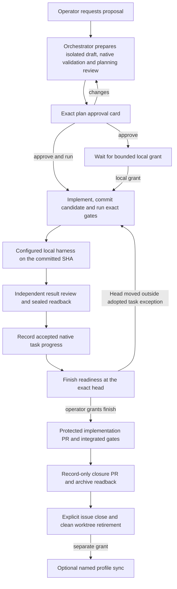
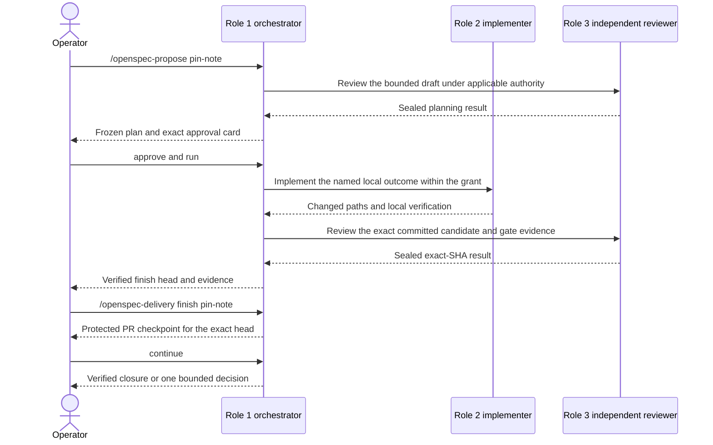

# OpenSpec operator tutorial

Start from the [workflow](openspec-workflow.md) and use the [operator runbook](openspec-operator-runbook.md)
for checkpoint and recovery commands. The integrated parent of the frozen plan
selects the policy. Use the original records when picking up a change in a new
session.

## Walk through one change





A verified adopting policy can reuse the sealed review of a checkbox-only
child's exact parent. This route still gates the child independently. Under
inherited policy, rerun the review for the actual final head after a task
commit.

Use the literal prompts in the applicable host form. In Codex, activate skills
with `$` and use the full change name after the worktree is registered. Follow
the [command map](openspec-workflow.md#host-spelling) for Claude marketplace and
direct installs.

| Example operator message | Effect |
| --- | --- |
| `/openspec-propose pin-note` followed by the goal | Prepare one proposal on the eligible baseline. Add `draft only` to stop with an uncommitted draft. |
| `changes: preserve keyboard access` | Revise the displayed plan within its scope, rerun required planning checks and present the new identity. |
| `approve` | Approve the exact displayed plan. Send `/openspec-next <full-change>` with a separate bounded local grant when ready. |
| `approve and run` | Record exact approval and the separate displayed local grant. Read back scope, roles, stop and budgets before launch. |
| `explicit` | Retain a per-run review override in the host admission file and obtain the exact single-run grant. |
| `/openspec-delivery finish <full-change>` | Authorize the named finish head's protected publication and closeout after positive readiness. External exceptions retain their own gates. |
| `continue` or `keep the worktree` | Resume the same protected PR/head after fresh readback, or narrow the retained cleanup authority. |

At a fresh-session checkpoint, open only the registered change worktree and its
records. Use the footer's starter and `$openspec-next inspect <full-change>`
to read back the frozen digest, candidate or interrupted attempt, grant,
restrictions and remaining budgets. Resume within the existing bounds once
the original process has settled or can be recovered. Changes to scope,
review binding, permissions, protected PR head or deadline require the
applicable operator decision. A new host session supplies no new authority.

## Configure AI roles

| Role | Configuration owned by the operator |
| --- | --- |
| **Role 1 · Orchestrator** | Bind the interactive client, provider, model, effort and version policy. It owns Git, `tasks.md`, evidence admission and protected closeout. |
| **Role 2 · Implementer** | Select a standalone bounded implementer allowed by the integrated policy, or the exact qualified exclusive binding. The implementation outcome, editable paths, time and correction budget belong in the request. |
| **Role 3 · Independent reviewer** | Select the installed reviewer, model, exact settings, phase and exposure. Keep a separate reviewer session. Review has read-only scope over its approved manifest. |
| **Role 4 · Optional AI helper or harness** | Select an explicit role tuple when enabled. The effective-binding gate currently blocks AI helper and AI harness execution. A configured non-AI harness uses the [standalone detached clone contract](openspec-review-configuration.md#optional-local-harness). |

### Role 1 · Interactive workset opener

OpenSpec **2.1.1** reads `openers.codex.args` from its user-global
`config.json` under `$XDG_CONFIG_HOME/openspec/` or the platform default.
An override replaces the built-in argument list. Generate the complete
entry with the [external AI roles and backend setup](configurable-backends.md).
Its `args` start with the launcher, `--launch-opener`, roles file path and
SHA-256. Setup pins the approved directory identities in that roles file.
For a workset that attaches multiple directories, include each exact
canonical member in the setup request's `worksetRoots` array. The Codex
native argument suffix preserves workspace-write.

```json
{
  "openers": {
    "codex": {
      "command": "/absolute/path/to/node",
      "args": ["/absolute/path/to/setup.mjs", "--launch-opener", "/private/host/roles.json", "ROLES_SHA256", "--sandbox", "workspace-write", "-m", "gpt-6.2-sol", "-c", "model_provider=\"openai\"", "-c", "model_reasoning_effort=\"high\""]
    }
  }
}
```

The 2.1.1 `attach-dirs` workset opener is disabled by default, including Codex
and Claude. If the operator explicitly enables that upstream feature for this
launch, the switch is `OPENSPEC_ENABLE_CLI_AGENT_OPENERS=1`. Read back the
primary member and writable roots. The opener starts in one primary cwd and
does not register a dedicated delivery worktree. A qualified standalone Codex
launcher with an exact `-C` and retained records is also available through the
runbook. [OpenSpec 2.1.1 opener source](https://github.com/Fission-AI/OpenSpec/blob/v2.1.1/src/core/openers.ts).

### Role 2 · Scoped implementer

The recorded legacy Linux pairing used Codex **0.171.0**, `gpt-6.2-sol`,
the dedicated `worker` profile and the native
`codex-native-named-workspace-write` adapter. Bind the effective model, client,
binary, profile, writable roots and attempt in the host registry. Other
standalone implementers require applicable local policy and their own
effective role readback. The explicit Codex pilot shares the same supervised
native route for standalone Goal-First and exclusive assignments.
[Qualified worker setup](worker-runtime.md).

### Role 3 · Direct-CLI independent review

Pin the external schema 3 `host.json` and the offline runtime readback.
The reviewer uses normal host authentication and a fresh disposable packet
workspace. Confirm the exact phase grant and reserve the complete cost before
provider contact. These settings show a serial launch with a 300000 ms timeout.

```json
{
  "schemaVersion": 3,
  "reviewer": {
    "client": "claude",
    "model": "claude-sonnet-4-6",
    "timeoutMs": 300000,
    "packetConcurrency": 1
  },
  "maxBudgetUsd": 2.5
}
```

Use the [direct Node launch](openspec-operator-runbook.md#launch-independent-review)
after offline export preflight and exact run admission.

## Optional Intent-Driven planning

Choose the reviewed external Intent-Driven schema **version 1** with OpenSpec
2.1.1. Pin the schema source to the operator-reviewed commit and copy its
complete `intent-driven` directory to `openspec/schemas/` only under a
separate project setup grant. Install optional authoring or executable
acceptance skills through their own reviewed setup. In a project that has
adopted the schema configuration, set `schema: intent-driven` in
`openspec/config.yaml`, or select it per new change with
`openspec new change <full-name> --schema intent-driven` after the naming and
workspace steps. Check the installed schema with
`openspec schema validate intent-driven`.
[Intent-Driven source and schema documentation](https://github.com/intent-driven-dev/openspec-schemas/tree/main/openspec/schemas/intent-driven).

Read `openspec status --change <full-name> --json` and
`openspec instructions apply --change <full-name> --json` to verify native
artifact paths before freezing. The upstream flow adds a change-local ADR
review manifest after specs and design and before tasks. Include that output
and any safe custom artifacts such as `adr/0001-decisions.md` in the bounded
draft inventory. Keep durable project-level ADRs under ordinary approved
project scope. The schema does not expand pre-freeze writes to those paths.
Record explicit scope and the required review for any such project-level edits.
The archive preserves the approved change-local files and their relative paths.

The selected integrated parent still governs delivery mode, exact approval,
task authority, scoped implementation, independent review and protected
closeout. The [configuration guide](openspec-review-configuration.md) shows
the adoption marker, offline review bounds and optional local harness.
